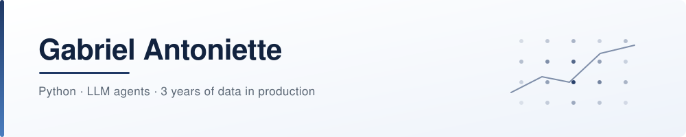
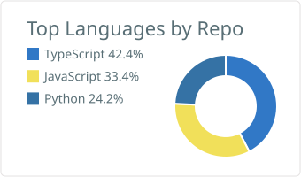
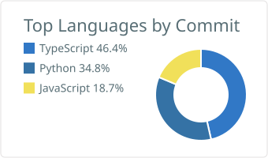

<p align="center">
  <picture>
    <source media="(prefers-color-scheme: dark)" srcset="assets/banner-dark.svg">
    <source media="(prefers-color-scheme: light)" srcset="assets/banner-light.svg">
    
  </picture>
</p>

<p align="center">
  
</p>

<p align="center">
  <a href="https://www.linkedin.com/in/gabriel-antoniette/">
    
  </a>
  <a href="mailto:gabrantoniette@gmail.com">
    
  </a>
  
  
</p>

---

### About

Short version: I spent three years making sure data was right before anyone made a decision with it. Now I'm doing the same thing one layer up, for models.

My current job is called Data Quality Analyst. What I actually do is find where a model gets things wrong: which field it misreads, which entities it misclassifies, how much of that would reach production if nobody checked. Around 20,000 transaction batches a week.

I don't have professional experience as an AI engineer yet. What I do have is three years of production data work, plus the systems I'm building on my own time to close the gap: RAG, multi-agent orchestration, API development.

Everything I build ends up here, working.

```python
from dataclasses import dataclass


@dataclass(frozen=True)
class Gabriel:
    now: str = "Data Quality Analyst, model evaluation in practice"
    heading: str = "AI Engineering"
    stack: tuple[str, ...] = ("Python", "FastAPI", "PostgreSQL", "Docker", "LLM agents")
    background: tuple[str, ...] = ("3 years as Data Analyst and Engineer", "Data Transformation", "Reports", "BI")
    education: tuple[str, ...] = (
        "Technologist Degree (2-year undergraduate): Data Science, FIAP",
        "Postgraduate, in progress: Software Engineering with Applied AI, UNIPDS",
    )
    languages: tuple[str, ...] = ("Portuguese (native)", "English (full professional proficiency)")

    def open_to(self) -> list[str]:
        return ["AI engineering roles"]
```

---

### Stack

<!-- stack:start -->
**AI and Python**

<p>
  
  
  
  
  
  
  
  
  
</p>

**Backend and data**

<p>
  
  
  
  
  
  
  
  
  
</p>

**Infrastructure**

<p>
  
  
  
  
</p>

**Frontend, when the project needs one**

<p>
  
  
  
  
  
  
</p>

**From the data years**

<p>
  
  
  
  
</p>
<!-- stack:end -->

---

### What I'm building

<!-- projects:start -->
#### [LangChain Implementation](https://github.com/gabrantoniette/lang-chain-implementation): a chat endpoint that routes by intent

<p>
  <a href="https://github.com/gabrantoniette/lang-chain-implementation">
    
  </a>
  
</p>

<p>
  <picture>
    <source media="(prefers-color-scheme: dark)" srcset="assets/generated/languages/lang-chain-implementation-dark.svg">
    
  </picture>
</p>

A Fastify endpoint backed by a LangGraph.js state graph. A question comes in at `POST /chat`, a first node works out what the message is asking for, and a conditional edge sends it to the node that handles it: make it uppercase, make it lowercase, or answer that the command is unknown. Every branch ends in the same node, which turns the result into the reply.

The commands are deliberately trivial, because the point is the graph itself: typed state, conditional routing and one node per responsibility. The intent step is keyword matching today, not a model, and the README says so. The graph also opens in LangSmith Studio with Chat mode available, which is what pushed me to build the state on `MessagesZodState`.

<details>
<summary><b>Decisions worth the click</b></summary>

<br>

- **State built on `MessagesZodState`.** It exposes `langgraph_type: "messages"` in the schema, which is what makes LangSmith Studio offer Chat mode; `output` and `command` have defaults so a client only has to send messages.
- **Routing is a conditional edge, not an `if` inside a node.** The intent node only labels the message; the graph decides where it goes, so adding a command means adding a node and a branch.
- **Three end-to-end tests through Fastify's `inject()`.** Upper case, lower case and unknown command run in-process, with no open port and no network.

</details>

<p>
  <code>TypeScript</code> <code>Node.js</code> <code>Fastify</code> <code>LangGraph</code> <code>LangChain</code>
</p>

<br>

#### [LLMs APIs Integrations](https://github.com/gabrantoniette/LLMs-APIs-integrations): a gateway that picks the model so the client doesn't

<p>
  <a href="https://github.com/gabrantoniette/LLMs-APIs-integrations">
    
  </a>
  
</p>

<p>
  <picture>
    <source media="(prefers-color-scheme: dark)" srcset="assets/generated/languages/LLMs-APIs-integrations-dark.svg">
    
  </picture>
</p>

A collection of reference implementations for putting an LLM behind an HTTP API. The first one is a small Fastify gateway: the client posts a question, and the gateway sends it to OpenRouter with an ordered list of candidate models. OpenRouter falls back through the list and picks the provider by price, latency or throughput, and the response says which model actually answered.

The routing policy lives in one config file, so changing the fallback order or the sort strategy never touches the service code. The gateway refuses to start without an API key, and the repository's `main` is protected behind a CI check.

<details>
<summary><b>Decisions worth the click</b></summary>

<br>

- **Model fallback and provider sorting are delegated to OpenRouter.** The gateway sends `models[]` plus `provider.sort`; it doesn't reimplement retries.
- **The response names the model that answered.** A client can always tell which fallback it got.
- **The tests hit the real OpenRouter API, so they are not run in CI.** They need a key and depend on live provider rankings; CI runs the type check, and the README says exactly that.

</details>

<p>
  <code>TypeScript</code> <code>Node.js</code> <code>Fastify</code> <code>OpenRouter</code>
</p>

<br>

#### [RAG Implementation](https://github.com/gabrantoniette/rag-implementation): a GraphRAG that checks its own answers

<p>
  <a href="https://github.com/gabrantoniette/rag-implementation">
    
  </a>
  
</p>

<p>
  <picture>
    <source media="(prefers-color-scheme: dark)" srcset="assets/generated/languages/rag-implementation-dark.svg">
    
  </picture>
</p>

A reusable GraphRAG in TypeScript. It loads documents into Neo4j (a vector index, a fulltext index and an entity graph), retrieves with vector and fulltext search fused together and expanded through the graph, and makes a single call to a free OpenRouter model. Then the answer is checked locally: every citation has to exist in the retrieved context, and every sentence is compared by embedding similarity with the passages it cites.

I built it around one question, can I trust this answer? A question the corpus can't answer is refused before the model is even called, and the Sources section is built by code from validated citations, never written by the model. The README reports numbers from commands in the repository, including the ones that went badly.

<details>
<summary><b>Decisions worth the click</b></summary>

<br>

- **A refusal is a correct answer.** An evidence gate refuses when the best passage scores below a threshold, which saves quota and avoids invention.
- **Zero cost, enforced.** Only free OpenRouter models are allowed, and a non-free one is refused before any request is made.
- **The reranker was not promoted.** Its nDCG@6 was 0.483 against 0.574 for the pass-through baseline, so the repository ships the baseline and says so. Adding the graph raised recall@6 from 0.813 to 0.875.
- **The domain is data, not code.** Prompts, corpus and evaluation sets live in a domain folder, and a test fails if domain vocabulary leaks into `src/core`.

</details>

<p>
  <code>TypeScript</code> <code>Neo4j</code> <code>OpenRouter</code> <code>TensorFlow.js</code> <code>Grafana</code>
</p>
<!-- projects:end -->

---

### GitHub at a glance

<!-- cards:start -->
<p align="center">
  <picture>
    <source media="(prefers-color-scheme: dark)" srcset="https://github-profile-summary-cards.vercel.app/api/cards/stats?username=gabrantoniette&theme=github_dark">
    <source media="(prefers-color-scheme: light)" srcset="https://github-profile-summary-cards.vercel.app/api/cards/stats?username=gabrantoniette&theme=default">
    
  </picture>
  <picture>
    <source media="(prefers-color-scheme: dark)" srcset="assets/generated/languages-by-repo-dark.svg">
    <source media="(prefers-color-scheme: light)" srcset="assets/generated/languages-by-repo-light.svg">
    
  </picture>
</p>
<!-- cards:end -->

<p align="center">
  <picture>
    <source media="(prefers-color-scheme: dark)" srcset="https://streak-stats.demolab.com/?user=gabrantoniette&hide_border=true&background=0D111700&border=30363D&stroke=30363D&ring=4A7DBF&fire=4A7DBF&currStreakLabel=4A7DBF&sideLabels=8B949E&dates=6E7681&currStreakNum=E6EDF3&sideNums=E6EDF3">
    <source media="(prefers-color-scheme: light)" srcset="https://streak-stats.demolab.com/?user=gabrantoniette&hide_border=true&background=FFFFFF00&border=D0D7DE&stroke=D0D7DE&ring=1F3864&fire=1F3864&currStreakLabel=1F3864&sideLabels=5A6674&dates=8B949E&currStreakNum=12233F&sideNums=12233F">
    
  </picture>
</p>

<p align="center">
  <picture>
    <source media="(prefers-color-scheme: dark)" srcset="https://github-profile-summary-cards.vercel.app/api/cards/profile-details?username=gabrantoniette&theme=github_dark">
    <source media="(prefers-color-scheme: light)" srcset="https://github-profile-summary-cards.vercel.app/api/cards/profile-details?username=gabrantoniette&theme=default">
    
  </picture>
</p>

<p align="center">
  <picture>
    <source media="(prefers-color-scheme: dark)" srcset="assets/generated/languages-by-commit-dark.svg">
    <source media="(prefers-color-scheme: light)" srcset="assets/generated/languages-by-commit-light.svg">
    
  </picture>
  <picture>
    <source media="(prefers-color-scheme: dark)" srcset="https://github-profile-summary-cards.vercel.app/api/cards/productive-time?username=gabrantoniette&theme=github_dark">
    <source media="(prefers-color-scheme: light)" srcset="https://github-profile-summary-cards.vercel.app/api/cards/productive-time?username=gabrantoniette&theme=default">
    
  </picture>
</p>

<p align="center">
  <sub>Some of my work lives in private repositories, so these charts tell part of the story, not all of it.</sub>
</p>

---

### Let's talk

If you hire for applied AI, or you build in this space and want to argue about something on this page, the inbox is open.

<p>
  <a href="https://www.linkedin.com/in/gabriel-antoniette/">
    
  </a>
  <a href="mailto:gabrantoniette@gmail.com">
    
  </a>
</p>

<sub>The language charts and the project language bars are drawn by this repository from my public repositories. The other stats cards are served by third-party open source projects. To host your own, see <a href="docs/self-host-stats.md">docs/self-host-stats.md</a>.</sub>
