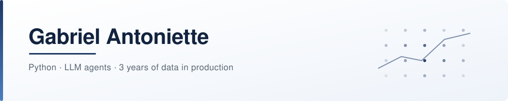
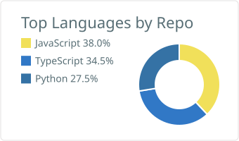
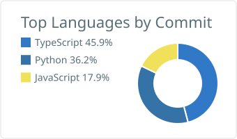

<p align="center">
  <picture>
    <source media="(prefers-color-scheme: dark)" srcset="assets/banner-dark.svg">
    <source media="(prefers-color-scheme: light)" srcset="assets/banner-light.svg">
    
  </picture>
</p>

<p align="center">
  
</p>

<p align="center">
  <a href="https://www.linkedin.com/in/gabriel-antoniette/">
    
  </a>
  <a href="mailto:gabrantoniette@gmail.com">
    
  </a>
  
  
</p>

---

### About

Short version: I spent three years making sure data was right before anyone made a decision with it. Now I'm doing the same thing one layer up, for models.

My current job is called Data Quality Analyst. What I actually do is find where a model gets things wrong: which field it misreads, which entities it misclassifies, how much of that would reach production if nobody checked. Around 20,000 transaction batches a week.

I don't have professional experience as an AI engineer yet. What I do have is three years of production data work, plus the systems I'm building on my own time to close the gap: RAG, multi-agent orchestration, API development.

Everything I build ends up here, working.

```python
from dataclasses import dataclass


@dataclass(frozen=True)
class Gabriel:
    now: str = "Data Quality Analyst, model evaluation in practice"
    heading: str = "AI Engineering"
    stack: tuple[str, ...] = ("Python", "FastAPI", "PostgreSQL", "Docker", "LLM agents")
    background: tuple[str, ...] = ("3 years as Data Analyst and Engineer", "Data Transformation", "Reports", "BI")
    education: tuple[str, ...] = (
        "Technologist Degree (2-year undergraduate): Data Science, FIAP",
        "Postgraduate, in progress: Software Engineering with Applied AI, UNIPDS",
    )
    languages: tuple[str, ...] = ("Portuguese (native)", "English (full professional proficiency)")

    def open_to(self) -> list[str]:
        return ["AI engineering roles"]
```

---

### Stack

<!-- stack:start -->
**AI and Python**

<p>
  
  
  
  
  
  
</p>

**Backend and data**

<p>
  
  
  
  
  
  
  
  
  
</p>

**Infrastructure**

<p>
  
  
  
  
</p>

**Frontend, when the project needs one**

<p>
  
  
  
  
  
  
</p>

**From the data years**

<p>
  
  
  
  
</p>

**Recently picked up**

<p>
  
</p>
<!-- stack:end -->

---

### What I'm building

<!-- projects:start -->
#### [LLMs-APIs-integrations](https://github.com/gabrantoniette/LLMs-APIs-integrations)

<p>
  <a href="https://github.com/gabrantoniette/LLMs-APIs-integrations">
    
  </a>
  
</p>

<p>
  <picture>
    <source media="(prefers-color-scheme: dark)" srcset="assets/generated/languages/LLMs-APIs-integrations-dark.svg">
    
  </picture>
</p>

Fastify gateway that routes LLM chat requests through OpenRouter with model fallback and price/latency/throughput sorting

<p>
  <code>Fastify</code> <code>Node.js</code> <code>OpenRouter</code> <code>TypeScript</code>
</p>

<br>

#### [rag-implementation](https://github.com/gabrantoniette/rag-implementation)

<p>
  <a href="https://github.com/gabrantoniette/rag-implementation">
    
  </a>
  
</p>

<p>
  <picture>
    <source media="(prefers-color-scheme: dark)" srcset="assets/generated/languages/rag-implementation-dark.svg">
    
  </picture>
</p>

Zero-cost, reusable GraphRAG in TypeScript: Neo4j vector + graph retrieval, free OpenRouter models, and locally verified citations with an evidence gate.

<p>
  <code>Grafana</code> <code>Neo4j</code> <code>OpenRouter</code> <code>TensorFlow</code> <code>TypeScript</code>
</p>

<br>

#### [ai-web](https://github.com/gabrantoniette/ai-web)

<p>
  <a href="https://github.com/gabrantoniette/ai-web">
    
  </a>
  
</p>

<p>
  <picture>
    <source media="(prefers-color-scheme: dark)" srcset="assets/generated/languages/ai-web-dark.svg">
    
  </picture>
</p>

On-device AI demos running 100% in the browser with Chrome's Built-in AI APIs (Gemini Nano): Prompt API, Translator and Language Detector.

<p>
  <code>JavaScript</code>
</p>
<!-- projects:end -->

---

### GitHub at a glance

<!-- cards:start -->
<p align="center">
  <picture>
    <source media="(prefers-color-scheme: dark)" srcset="https://github-profile-summary-cards.vercel.app/api/cards/stats?username=gabrantoniette&theme=github_dark">
    <source media="(prefers-color-scheme: light)" srcset="https://github-profile-summary-cards.vercel.app/api/cards/stats?username=gabrantoniette&theme=default">
    
  </picture>
  <picture>
    <source media="(prefers-color-scheme: dark)" srcset="assets/generated/languages-by-repo-dark.svg">
    <source media="(prefers-color-scheme: light)" srcset="assets/generated/languages-by-repo-light.svg">
    
  </picture>
</p>
<!-- cards:end -->

<p align="center">
  <picture>
    <source media="(prefers-color-scheme: dark)" srcset="https://streak-stats.demolab.com/?user=gabrantoniette&hide_border=true&background=0D111700&border=30363D&stroke=30363D&ring=4A7DBF&fire=4A7DBF&currStreakLabel=4A7DBF&sideLabels=8B949E&dates=6E7681&currStreakNum=E6EDF3&sideNums=E6EDF3">
    <source media="(prefers-color-scheme: light)" srcset="https://streak-stats.demolab.com/?user=gabrantoniette&hide_border=true&background=FFFFFF00&border=D0D7DE&stroke=D0D7DE&ring=1F3864&fire=1F3864&currStreakLabel=1F3864&sideLabels=5A6674&dates=8B949E&currStreakNum=12233F&sideNums=12233F">
    
  </picture>
</p>

<p align="center">
  <picture>
    <source media="(prefers-color-scheme: dark)" srcset="https://github-profile-summary-cards.vercel.app/api/cards/profile-details?username=gabrantoniette&theme=github_dark">
    <source media="(prefers-color-scheme: light)" srcset="https://github-profile-summary-cards.vercel.app/api/cards/profile-details?username=gabrantoniette&theme=default">
    
  </picture>
</p>

<p align="center">
  <picture>
    <source media="(prefers-color-scheme: dark)" srcset="assets/generated/languages-by-commit-dark.svg">
    <source media="(prefers-color-scheme: light)" srcset="assets/generated/languages-by-commit-light.svg">
    
  </picture>
  <picture>
    <source media="(prefers-color-scheme: dark)" srcset="https://github-profile-summary-cards.vercel.app/api/cards/productive-time?username=gabrantoniette&theme=github_dark">
    <source media="(prefers-color-scheme: light)" srcset="https://github-profile-summary-cards.vercel.app/api/cards/productive-time?username=gabrantoniette&theme=default">
    
  </picture>
</p>

<p align="center">
  <sub>Some of my work lives in private repositories, so these charts tell part of the story, not all of it.</sub>
</p>

---

### Let's talk

If you hire for applied AI, or you build in this space and want to argue about something on this page, the inbox is open.

<p>
  <a href="https://www.linkedin.com/in/gabriel-antoniette/">
    
  </a>
  <a href="mailto:gabrantoniette@gmail.com">
    
  </a>
</p>

<sub>The language charts and the project language bars are drawn by this repository from my public repositories. The other stats cards are served by third-party open source projects. To host your own, see <a href="docs/self-host-stats.md">docs/self-host-stats.md</a>.</sub>
